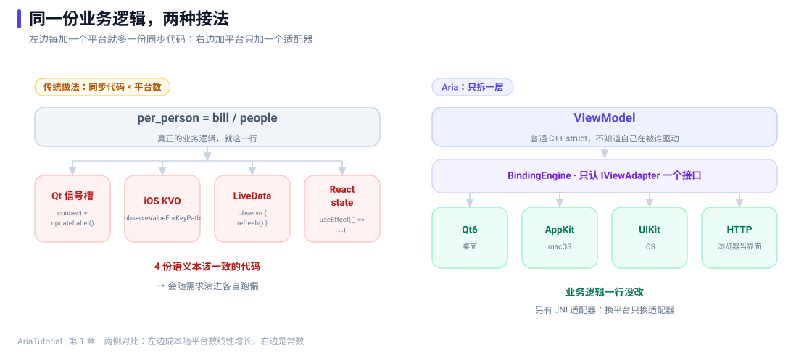

<div align="center">

# AriaTutorial

[依赖更新完整指南](docs/dependencies.md) — 版本固定、选择性更新、离线、回退与提交步骤。

**Aria 从入门到精通 · 20 篇中文教程 + 可运行 demo**

每章一个独立可跑的 demo，正文代码与仓库代码同源，照着敲就能跑通。

[](https://github.com/dqsjqian/AriaTutorial/releases/tag/v0.2.0)
[](https://github.com/dqsjqian/Aria)
[](#环境要求)
[](LICENSE)



</div>

---

## 这是什么

[Aria](https://github.com/dqsjqian/Aria) 是为工业级跨平台软件而生的现代 C++ MVVM 框架，将响应式状态、异步协程与跨端绑定统一为独立于 UI 工具包的架构。ViewModel 是纯 C++ 类，无需继承框架基类、编写宏或运行代码生成器；一套业务核心驱动多端原生界面。

这套教程带你掌握这份设计的优雅与工程实力：从一次状态更新，到异步取消、集合增量更新和平台适配，把可维护的跨端架构落实到代码。

这套教程按「入门 → 响应式核心 → 集合与表单 → 架构与适配 → 精通」五个阶段展开，共 20 章。每一章都配一个可以编译、可以运行、可以看到输出的最小 demo —— 教程里贴的每一段输出都是这些程序真实打印出来的。

## 快速开始

安装构建工具后，注册一个可供所有项目共享的工作区：

```bash
python -m pip install -r requirements-build.txt
python -m forgedeps init /path/to/ForgeDepsWorkspace
python scripts/build.py --test
```

默认从 `dependencies.json` 的已解析锁准备源码和 SDK；构建不自动选择新版本。`FORGEDEPS_HOME` 可覆盖已注册工作区。源码位于工作区 `sources/`，Aria 和第三方产物位于 `build/<name>/<target>/`；应用直接链接此处，每个目标只保留当前产物。版本、编译器、ABI、源码或配方变化会触发显式构建替换，失败保留旧产物。

`--aria-root /path/to/Aria`（CMake 的 `ARIA_DIR`，Tutorial 为 `ARIA_ROOT`）提供可编辑源码；其内容仍被哈希并编译进共享 SDK，不再嵌入应用子目录。Qt、NDK 和 Apple SDK 由用户安装，实际工具链与 Qt 内容进入产物身份。更新版本使用 `scripts/ci/update_dependencies.py`，审查并提交锁文件。

Python 入口持有配置、编译、测试和部署所需的消费锁。手工命令使用 `python -m forgedeps.build_kit.session --configure -- cmake -S ... -B ...`，后续构建/测试使用 `python -m forgedeps.build_kit.session --build-dir <build> -- <command>`。离线构建要求已准备对应源码、归档和工具链；不兼容或被改动的产物会失败。

`fetch_aria.py` 只用于单独准备共享源码；本地镜像开发 checkout 使用 `--source <repo> --destination <path>`。默认应用构建不需要先运行此命令。

默认构建 19 个示例；`--all-demos --test` 构建 Qt6 与 HTTP 在内的 21 个示例。`--aria-prefix <prefix>` 可消费锁定精确版本的既有 SDK，与 `--aria-root` 互斥。

## 章节目录

| # | 章节 | demo | 正文 |
|---|---|------|------|
| 01 | 为什么再造一个 C++ MVVM 框架 | `ch01_bill` | [中文](docs/01-为什么再造一个C++MVVM框架.md) · [English](docs/01-why-another-cpp-mvvm-framework.en.md) |
| 02 | 十分钟跑起第一个响应式程序 | `ch02_hello` | [中文](docs/02-十分钟跑起第一个响应式程序.md) · [English](docs/02-first-reactive-program-in-ten-minutes.en.md) |
| 03 | Property 精讲：读写、追踪与等值门 | `ch03_property` | [中文](docs/03-Property精讲-读写追踪与等值门.md) · [English](docs/03-property-in-depth.en.md) |
| 04 | Computed 的魔法：自动依赖追踪 | `ch04_computed` | [中文](docs/04-Computed的魔法-自动依赖追踪.md) · [English](docs/04-computed-dependency-tracking.en.md) |
| 05 | batch / untracked / Effect：精确控制通知范围 | `ch05_batch` | [中文](docs/05-batch-untracked-Effect.md) · [English](docs/05-batch-untracked-effect.en.md) |
| 06 | Subscription：用作用域表达订阅的生命周期 | `ch06_subscription` | [中文](docs/06-Subscription-生命周期与RAII.md) · [English](docs/06-subscription-lifetime-and-raii.en.md) |
| 07 | 两个必踩的坑：幽灵依赖与循环依赖 | `ch07_pitfalls` | [中文](docs/07-幽灵依赖与循环依赖.md) · [English](docs/07-phantom-and-circular-dependencies.en.md) |
| 08 | Command 与 AsyncCommand：动作也要有状态 | `ch08_command` | [中文](docs/08-Command与AsyncCommand.md) · [English](docs/08-command-and-async-command.en.md) |
| 09 | ObservableList：会通知变化的列表 | `ch09_list` | [中文](docs/09-ObservableList.md) · [English](docs/09-observable-list.en.md) |
| 10 | 派生视图：筛选、排序、去重、分页 | `ch10_derived` | [中文](docs/10-派生视图.md) · [English](docs/10-derived-views.en.md) |
| 11 | reconcile：用一份新数据刷新列表 | `ch11_reconcile` | [中文](docs/11-reconcile增量更新.md) · [English](docs/11-reconcile.en.md) |
| 12 | Validator：校验也是响应式的 | `ch12_validation` | [中文](docs/12-Validator表单校验.md) · [English](docs/12-validator.en.md) |
| 13 | ViewModel 生命周期：激活、父子树、销毁钩子 | `ch13_viewmodel` | [中文](docs/13-ViewModel生命周期.md) · [English](docs/13-viewmodel-lifecycle.en.md) |
| 14 | BindingEngine：把 Property 接到界面 | `ch14_binding` | [中文](docs/14-BindingEngine.md) · [English](docs/14-binding-engine.en.md) |
| 15 | 适配器体系：一份 ViewModel 接五种界面 | `ch15_qt6` `ch15_http` | [中文](docs/15-适配器体系.md) · [English](docs/15-adapter-layer.en.md) |
| 16 | 自己动手写一个 IViewAdapter | `ch16_adapter` | [中文](docs/16-自己写适配器.md) · [English](docs/16-writing-an-adapter.en.md) |
| 17 | 协程、并发与取消 | `ch17_async` | [中文](docs/17-协程与取消.md) · [English](docs/17-coroutines-and-cancellation.en.md) |
| 18 | 诊断：把响应式图导出来看 | `ch18_diagnostics` | [中文](docs/18-诊断.md) · [English](docs/18-diagnostics.en.md) |
| 19 | 测试：怎么验证响应式代码是对的 | `ch19_testing` | [中文](docs/19-测试.md) · [English](docs/19-testing.en.md) |
| 20 | 综合实战：用 Aria 写一个待办清单 | `ch20_ecosystem` | [中文](docs/20-综合实战.md) · [English](docs/20-putting-it-together.en.md) |

## 环境要求

| 项 | 要求 |
|---|---|
| CMake | >= 3.21 |
| 编译器 | MSVC v143+ (VS 2022/2026) / GCC 14+ / Clang 19+ / AppleClang 21+ |
| C++ 标准 | C++23 基线（随 Aria 框架要求） |
| 其他依赖 | 默认章节使用 Aria 的 core、async、runtime 和 binding，不需要 UI 工具包 |

> 第 15 章涉及 Qt6 与 HTTP 适配器，对应的两个 demo 默认不参与构建，需要 `-DARIA_TUTORIAL_QT6=ON` / `-DARIA_TUTORIAL_HTTP=ON` 才会启用。正文会单独说明。

### Windows 提示

`.ps1` 脚本要求编译环境已就绪：用 **Developer PowerShell for VS** 打开，或先确保 `cmake`、`cl.exe` 在 `PATH` 中。

## 仓库结构

```
AriaTutorial/
├── CMakeLists.txt              # 顶层构建：定位 Aria + 汇总 demo
├── demos/
│   ├── CMakeLists.txt          # 每章一个 target，ch15 的两个用开关隔离
│   ├── common/                 # 各章共用的辅助代码（教程用内存适配器）
│   ├── ch01_bill/main.cpp
│   ├── ch02_hello/main.cpp
│   ├── ...                     # ch03 - ch20，默认 19 个目标，启用 Qt6/HTTP 后共 21 个
│   ├── ch15_qt6/main.cpp       # 需要 Qt6
│   ├── ch15_http/main.cpp      # 需要 Aria HTTP 模块
│   └── ch20_ecosystem/main.cpp
├── docs/                       # 教程正文，全文中英双版本（40 篇）
│   ├── 01-为什么再造一个C++MVVM框架.md
│   ├── 01-why-another-cpp-mvvm-framework.en.md
│   └── ...                     # 中文用中文文件名，英文版一律 ASCII 名 + .en.md
├── images/                     # 每章一张配图（SVG 矢量，中英各一版），可编辑、可 diff
│   ├── ch01-why-aria.zh.svg
│   ├── ch01-why-aria.en.svg
│   └── ...
└── scripts/
    ├── run-all.ps1
    └── run-all.sh
```

## 正文里的图

每一章正文的标题下方都有一张配图，画的是那一章最核心的那件事 —— 数据流、依赖图、状态机或时间线。

配图不是凭空画的示意图，它们与正文一样受同一条规则约束：**图里出现的每个数字都来自该章 demo 的真实运行结果**。比如第 4 章的重算次数（1 → 2 → 3）、第 11 章的编辑操作计数、第 17 章的并发实测耗时（62ms），都能靠 `build/bin/chNN_xxx` 亲手复现。

配图本身就是 SVG（`images/*.svg`），可以改文案、改配色；GitHub 原生渲染矢量图，不需要再导出 PNG。

## 正文与 demo 的一致性

正文代码以 `demos/` 中的实现为依据。修改示例时，需要同步检查代码摘录、输出和配图；当前 CI 自动构建并运行 demo，不会逐字比对所有正文和 SVG 内容。

运行 `ctest --test-dir build --output-on-failure` 验证已启用的示例，每个测试限时 30 秒。第 15 章启用后使用 `--smoke`：Qt 检查标签、按钮和状态更新，HTTP 检查临时端口启动、状态更新与停止。它们不替代完整的 GUI 或浏览器交互测试。

2026-09-30 已使用 Aria `27fda0e03571` 在 macOS / AppleClang 21 下通过全部 21 个示例测试（含 Qt6 与 HTTP）。正文保留的历史耗时不代表每台机器的预期输出。

## 相关仓库

| 仓库 | 说明 |
|---|---|
| [Aria](https://github.com/dqsjqian/Aria) | 框架本体：响应式核心 + 绑定层 + 五个适配器 |
| [AriaTools](https://github.com/dqsjqian/AriaTools) | 旗舰示例：同一份 ViewModel 驱动 Qt / iOS / Android / Web 四端 |
| [AriaAgent](https://github.com/dqsjqian/AriaAgent) | Provider 无关的 LLM Agent GUI |
| [AriaRead](https://github.com/dqsjqian/AriaRead) | 跨平台书源引擎，HTTP 适配器驱动的 Web 端 |

## License

[MIT](LICENSE) © 2026 aria contributors

自有代码采用 MIT；第三方组件保留各自协议。分发说明见 [第三方许可声明](THIRD_PARTY_NOTICES.md)。
